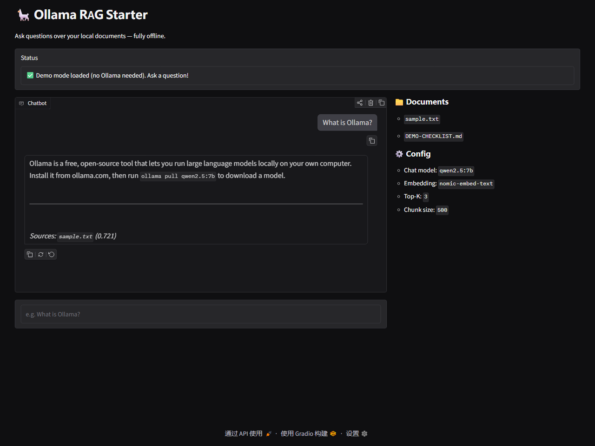

# ollama-rag-starter

A minimal local RAG (Retrieval-Augmented Generation) starter built on
[Ollama](https://ollama.com) and NumPy. Drop `.txt` / `.md` files into `docs/`,
ask questions, and get answers grounded in those files. No vector database, no
LangChain, no API keys, no cloud calls after the models are downloaded.

## What it does

- Loads every `.txt` / `.md` file under `docs/` (recursively).
- Splits each document into overlapping character chunks.
- Embeds every chunk with an Ollama embedding model (`nomic-embed-text` by default).
- Embeds the question, ranks chunks by cosine similarity, and takes the top K.
- Sends only those chunks to an Ollama chat model (`qwen2.5:7b` by default) with a
  "answer from the context only" prompt, and returns the answer plus the source
  file names.

Two entry points share the same pipeline:

- `rag.py` — command-line loop.
- `app.py` — Gradio web UI (`--demo` gives mock answers and does not need Ollama).

The whole pipeline is about 130 lines in `rag.py`; there is no indexing service
and no on-disk vector store — the index is rebuilt in memory on each run.

## Requirements

- Python 3.9+
- [Ollama](https://ollama.com/download) installed and running locally
  (not needed for `python app.py --demo`)
- Ollama models:
  - `nomic-embed-text` for embeddings
  - `qwen2.5:7b` for chat (or another chat model — see Configuration)

```bash
ollama pull nomic-embed-text
ollama pull qwen2.5:7b
```

`qwen2.5:3b` needs noticeably less RAM/VRAM if `7b` is too large.

The web UI uses Gradio (`gradio>=4.44.0`, pinned in `requirements.txt` because
`app.py` passes `placeholder` to `gr.Chatbot`); the CLI alone only needs
`ollama` and `numpy`.

## Install

```bash
git clone https://github.com/i-am-cie/ollama-rag-starter.git
cd ollama-rag-starter
python -m venv .venv
# Windows: .venv\Scripts\activate
# macOS/Linux: source .venv/bin/activate
pip install -r requirements.txt
```

## Run

### CLI

```bash
python rag.py
```

It indexes `docs/`, then prompts for questions until you type `exit` or `quit`.
Each answer is followed by the retrieved source file names and their cosine
scores.

### Web UI

```bash
python app.py
# open http://127.0.0.1:7860
```

To try the UI without Ollama, run it in demo mode — answers are fixed mock text,
clearly labelled as demo mode in the status line, and no model is called:

```bash
python app.py --demo
```



*The screenshot above is the UI in `--demo` mode (mock answers, no Ollama
required); it is not a recording of a real model answer.*

### Add your own documents

Put any `.txt` or `.md` files into `docs/` and restart. `docs/sample.txt` is a
small example document; replace it or leave it alongside your own files.

## Tests

`rag.py` ships with a pytest suite covering document loading, overlapping
chunking, cosine retrieval ordering, index building, and the answer prompt
assembly. The Ollama embed/chat calls are mocked, while the NumPy vectors are
real, so the tests run without Ollama, network access, or the Gradio UI:

```bash
pip install -r requirements-dev.txt
pytest tests/ -v
```

A GitHub Actions workflow (`.github/workflows/tests.yml`) runs the suite on
every push to `main` and on pull requests. The tests check the pipeline's own
chunking, retrieval and prompt logic; they do not evaluate the quality of the
model's answers.

## Usage

Ask questions in natural language, for example:

- "What does RAG stand for?"
- "How do I install Ollama?"
- "Why should I run RAG locally?"

The answer is generated only from the retrieved chunks. If the context does not
contain the answer, the prompt asks the model to say it does not know — though as
with any LLM, this is not guaranteed.

## Configuration

`rag.py` and `app.py` each define their own constants at the top of the file, so
change both if you use both entry points.

| Setting | Where | Default |
|---|---|---|
| `EMBED_MODEL` | constant in `rag.py` / `app.py` | `nomic-embed-text` |
| `CHAT_MODEL` | constant in `rag.py` / `app.py` | `qwen2.5:7b` |
| `CHUNK_SIZE` | constant | `500` characters |
| `CHUNK_OVERLAP` | constant | `80` characters |
| `TOP_K` | constant | `3` chunks |
| `DOCS_DIR` | constant | `docs` |
| `OLLAMA_HOST` | environment variable, read by the `ollama` Python client | `http://localhost:11434` |

```bash
# Point the client at a different Ollama server
OLLAMA_HOST=http://192.168.1.20:11434 python rag.py
```

Changing `CHAT_MODEL` to `qwen2.5:3b` is the simplest way to lower memory use;
changing `EMBED_MODEL` requires pulling that model and keeping the same embedding
model for both indexing and queries.

## How it works

```
docs/*.txt|*.md
      │
      ▼
load_documents() ──► chunk_text() ──► embed() ──► NumPy array (in memory)
                                                       │
question ──► embed() ──► cosine similarity ──► top-K chunks
                                                       │
                                                       ▼
                                   prompt (context + question) ──► Ollama chat
                                                       │
                                                       ▼
                                             answer + source file names
```

- `load_documents()` reads text files and keeps `(filename, content)` pairs.
- `chunk_text()` slices each document into overlapping character windows.
- `embed()` calls `ollama.embed()` and converts the vectors to `float32` arrays.
- `retrieve()` normalises the vectors and computes cosine similarity with a
  matrix multiply.
- `answer()` / `real_answer()` build the prompt, call `ollama.chat()`, and return
  the answer with the retrieved sources.

Everything runs locally; nothing is sent to a remote service.

## Limitations

- **Character chunking.** Windows can split sentences or code blocks mid-way;
  there is no sentence- or paragraph-aware splitting.
- **No persistent index.** All documents are re-read and re-embedded on every
  start, which is slow for large collections.
- **Whole corpus is embedded in one request.** Each embedding call sends all
  chunks at once; a large `docs/` folder can be slow and memory-hungry.
- **Text formats only.** Only `.txt` and `.md` are loaded — no PDF, DOCX, or HTML.
- **No reranking or hybrid search.** Retrieval is pure cosine similarity on
  embeddings; top-K is fixed.
- **No conversation memory.** Each question is answered independently; the chat
  history is not fed back to the model.
- **No citations in the prose.** Source file names and scores are returned
  alongside the answer, but the answer text does not cite specific chunks.
- **Demo mode is fake by design.** `python app.py --demo` returns canned answers
  from `DEMO_ANSWERS`; it exists to preview the UI, not to answer questions.
- **Tests cover the pipeline, not the model.** The pytest suite checks loading,
  chunking, retrieval and prompt assembly; answer quality still depends on the
  local model.

## License

[MIT](./LICENSE) © 2026 i-am-cie

## 中文说明

一个极简的本地 RAG（检索增强生成）起步项目：用 Ollama 做 embedding 和对话，
用 NumPy 算余弦相似度，不依赖向量数据库、LangChain 或任何 API key。

- **功能**：读取 `docs/` 下的 `.txt` / `.md` → 按字符切片 → 用 `nomic-embed-text` 生成向量 → 问题向量与所有切片做余弦相似度 → 取最相关的 3 段拼进提示词 → 用 `qwen2.5:7b` 生成只基于这些内容的回答，并附上来源文件名和分数。
- **入口**：`python rag.py`（命令行问答）、`python app.py`（Gradio 网页界面，地址 http://127.0.0.1:7860）、`python app.py --demo`（无需 Ollama 的演示模式，回答是写死的假数据，仅用于看界面）。
- **依赖**：Python 3.9+、本地 Ollama、模型 `nomic-embed-text` 和 `qwen2.5:7b`（显存小可换 `qwen2.5:3b`）。
- **安装**：`pip install -r requirements.txt`。
- **测试**：仓库自带 pytest 用例，覆盖文档加载、重叠切片、余弦检索排序、索引构建与回答提示词拼装；Ollama 的 embed/chat 调用打桩，向量计算用真实 NumPy，无需启动 Ollama 或联网即可运行，GitHub Actions 在 push / PR 时自动执行。本地运行：`pip install -r requirements-dev.txt && pytest tests/ -v`。
- **配置**：`EMBED_MODEL`、`CHAT_MODEL`、`CHUNK_SIZE`、`CHUNK_OVERLAP`、`TOP_K`、`DOCS_DIR` 都是 `rag.py` / `app.py` 顶部的常量；`OLLAMA_HOST` 是环境变量，由 `ollama` Python 客户端读取，默认 `http://localhost:11434`。
- **限制**：按字符切片可能切断句子；每次启动都重新建索引、不落盘；整个语料一次请求做 embedding，文档多时会慢且吃内存；只支持 `.txt` / `.md`；没有重排序、没有对话记忆；`--demo` 模式返回的是写死的演示回答。
- **License**：MIT。
